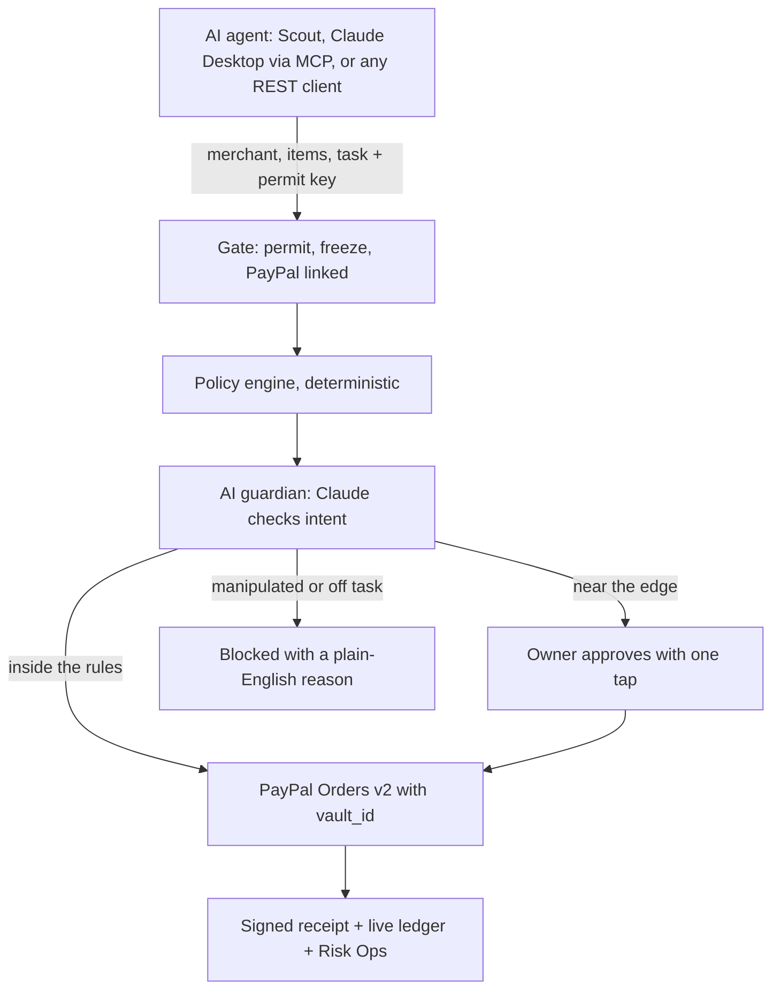

# Valet: a valet key for AI agents to pay with PayPal

**Let agents pay. Keep the keys.** Valet gives any AI agent a scoped, revocable permission to pay with PayPal, and checks every payment against what you actually asked for.

Built for the [PayPal AI Hackathon 2026](https://paypalaihackathon.devpost.com/). Sandbox prototype; not affiliated with or endorsed by PayPal.

- **Demo video:** add your YouTube link
- **Live demo:** add your Render URL (each visitor gets a private demo account)


## Why

74% of consumers let AI agents execute tasks, but only 9% let them complete purchases ([Accenture Consumer Pulse Research 2026](https://www.accenture.com/gb-en/insights/consulting/talk-my-ai-agent), 25,590 consumers, 16 countries). Payment is the highest hurdle in the whole journey. Accenture names the four safeguards that unlock it: configurable permissions, instant override, clear recourse and data safeguards. Valet ships all four on PayPal rails.

PayPal's CEO put it plainly on the Q3 2026 earnings call: agentic commerce "is really all about trust." Today a person can either hand an agent full payment credentials or approve every purchase by hand. Valet is the middle ground.

## What it does

1. **Link PayPal once.** The PayPal JS SDK v6 save flow vaults the owner's wallet (Vault v3 setup token, then payment token). Agents never see it.
2. **Write the rules in a sentence.** "Weekly house shopping up to $250 a week, ask me over $75, never gift cards." Claude compiles it into enforceable rules, shown as chips the owner checks before issuing.
3. **Give each agent its own key.** Scoped, expiring, stored only as a hash. Revoke one without touching the others.
4. **Every payment is decided in three steps.** A gate (permit active, owner not frozen, PayPal linked), a deterministic policy engine, then an AI guardian that checks intent: does the cart serve the owner's task, and is anything manipulating the agent? **AI can tighten, never loosen.**
5. **Approve, ask or block.** Inside the rules, PayPal charges the vaulted wallet (Orders v2 with `vault_id`). Near the edge, the owner approves with one tap, on desktop or phone. Manipulated or off task, Valet blocks it and explains why.
6. **Recourse and proof.** One-tap refunds through the Refunds API, an evidence bundle for disputes, and an ES256-signed receipt on every payment that merchants verify against Valet's JWKS.

| | |
| --- | --- |
|  |  |
|  |  |

## Features

| Feature | Where |
| --- | --- |
| Link PayPal with the JS SDK v6 vault flow, or a one-click sandbox demo wallet | `/app` |
| Plain-English permits compiled by Claude, editable before issuing | `/app/permits/new` |
| Policy engine: amount integrity, never-lists, caps, burst limit, scope, lookalike merchants, budget, duplicates, approval threshold | `src/lib/policy.ts` |
| AI guardian (Claude Opus 5.5, structured output) with a deterministic fallback that fails closed | `src/lib/guardian.ts` |
| One-tap approvals with a QR code for the phone | `/app`, `/approve/[id]` |
| Instant override: pause, revoke, freeze all, unlink PayPal | header, permit cards |
| Activity ledger on AG Grid with master detail decision traces, refunds and evidence | `/app/activity` |
| Scout, a demo shopping agent (Claude tool use) that can only pay through Valet | `/agent` |
| Red team lab: six attacks against a live permit | `/redteam` |
| Risk Ops console for PayPal's risk team, queried in plain English with AG Grid's AI Toolkit | `/ops` |
| Signed receipts and a merchant verifier | `/verify`, `/.well-known/jwks.json` |
| Concierge: Claude with the PayPal Agent Toolkit, limited to read and refund | `/app` |
| REST Agent Pay API and an MCP server for any agent | `/developers` |
| Verified PayPal webhooks for captures, refunds, reversals, disputes and vault deletions | `/api/webhooks/paypal` |

## How a payment flows



## PayPal integration

| API | Use in Valet | Code |
| --- | --- | --- |
| OAuth 2.0 (`response_type=client_token`) | Browser-safe client token for the JS SDK v6 | `src/lib/paypal.ts` |
| JS SDK v6 `createPayPalSavePaymentSession` | Owner links PayPal without a purchase | `src/components/PayPalLink.tsx` |
| Vault v3 setup and payment tokens | Long-lived wallet token, kept server side | `src/lib/paypal.ts` |
| Orders v2 with `payment_source.paypal.vault_id` | Customer-not-present agent payments, idempotent via `PayPal-Request-Id` | `chargeVault` |
| Payments v2 refunds | One-tap refunds | `refundCapture` |
| Webhooks + `verify-webhook-signature` | Captures, refunds, reversals, disputes, vault deletions | `src/app/api/webhooks/paypal/route.ts` |
| PayPal Agent Toolkit | The concierge's read and refund tools | `src/lib/concierge.ts` |

## AI

- **Claude Opus 5.5** compiles permits, runs the guardian, drives Scout and the concierge, and answers grid queries. Structured outputs (`output_config.format`) plus zod validation; server-side refusal fallback enabled.
- **AG Grid AI Toolkit:** the grid describes its own state as a JSON schema (`getStructuredSchema`), Claude fills it from plain English, the grid applies it (`setState`).
- **Fallbacks:** without an Anthropic key, a deterministic rules guardian and compiler take over, so judges always get a working product.

## Run it

```bash
npm install
cp .env.example .env.local
npm run dev
```

Open http://localhost:3000. With no keys, Valet runs a labelled PayPal simulator and the rules guardian.

**PayPal sandbox:** create a REST app at developer.paypal.com, enable **Save payment methods** in the app's features, then set `PAYPAL_CLIENT_ID` and `PAYPAL_CLIENT_SECRET`. For the one-click demo wallet, link once with the PayPal button and copy the payment token into `DEMO_VAULT_ID`. Register `https://<host>/api/webhooks/paypal` and set `PAYPAL_WEBHOOK_ID`.

**Claude:** set `ANTHROPIC_API_KEY`. The model defaults to `claude-opus-5-5`.

**AG Grid:** Enterprise features run in trial mode with a watermark; set `NEXT_PUBLIC_AG_GRID_LICENSE_KEY` to remove it.

## Connect an agent

```bash
curl -X POST "$VALET_URL/api/agent/pay" \
  -H "Authorization: Bearer $VALET_PERMIT" \
  -H "Content-Type: application/json" \
  -d '{"merchant":{"name":"FreshCart","domain":"freshcart.com"},"items":[{"name":"Paper towels, 6 rolls","sku":"fc-towels","category":"household","unit_price":13.5,"quantity":1}],"task":"Restock paper towels"}'
```

Claude Desktop (MCP), in `claude_desktop_config.json`:

```json
{
  "mcpServers": {
    "valet": {
      "command": "npx",
      "args": ["-y", "mcp-remote", "https://<host>/api/mcp", "--header", "Authorization:${VALET_AUTH}"],
      "env": { "VALET_AUTH": "Bearer vlt_sb_..." }
    }
  }
}
```

A Postman collection is in `postman/`.

## Test

```bash
npm test
```

```bash
npm run smoke
```

`npm test` runs 19 unit tests on the policy engine, compiler and guardian. `npm run smoke` runs 39 end-to-end checks over HTTP against a running server (`BASE_URL`), including all six red team attacks.

## Deploy

Render: **New > Blueprint**, point it at this repo, and fill in the secrets from `render.yaml`. Any Node 20+ host works with `npm run build` and `npm start`.

## Demo assets

`npm run record` drives the real app in Chromium and saves feature clips and 2x screenshots to `demo/out/`. `npm run ad` renders the 53 second ad from `demo/ad/ad.html` with an original synthesized soundtrack. The YouTube script is in [`demo/SCRIPT.md`](demo/SCRIPT.md).

## Security notes

- Agents hold scoped Valet keys only; the PayPal payment token never leaves the server.
- Keys are stored as SHA-256 hashes and shown once.
- The model can block or escalate, never approve beyond the written rules.
- If Claude is unavailable, the rules guardian decides (fail closed, never fail open).
- Webhooks are signature-verified with PayPal before they change state.
- Receipts are ES256 JWS with a published JWKS.

## Project layout

```
src/app           Next.js pages and API routes
src/lib           decision engine, PayPal client, Claude helpers, MCP, red team
src/components    UI kit, AG Grid ledgers, approval cards
tests             unit tests
scripts           smoke test, demo recorder, ad renderer, soundtrack synth
demo              ad composition and the YouTube script
```

## Built with

PayPal (Vault v3, Orders v2, Payments, Webhooks, JS SDK v6, Agent Toolkit), Claude Opus 5.5 (Anthropic API), AG Grid Enterprise with the AI Toolkit, Model Context Protocol, Next.js, React, Tailwind CSS, jose, Render. Developed with Claude Code as an AI pair programmer.

## License

MIT. See [LICENSE](LICENSE).
